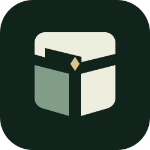

# BroKnowMyTrove



**兄弟懂我的保险箱** · 便携文件加密软件

[](rust-toolchain.toml)


[](https://doc.libsodium.org/)


[简体中文](#简体中文) · [English](#english)

---

## 简体中文

**离线跨平台加密文件保险库。** 不用注册，也不依赖云服务。保险库可以放在本地磁盘、移动介质或已完整下载的云盘目录；一个 `bkmt` 程序，同时支持图形界面与命令行。

### 开始使用

```sh
./bkmt         # 打开图形界面
./bkmt --help  # 查看命令行用法
```

从源码构建：

```sh
cargo build --release --locked
```

产物为 `target/release/bkmt`，Windows 为 `bkmt.exe`。源码构建需要本机 C/C++ 工具链；默认 GUI 构建在 Linux 上还需要图形开发库，运行 GUI 需要桌面环境。面向 Windows、macOS、Linux 的 x86_64 / ARM64。

Rust 编写 · egui/eframe 界面 · libsodium 密码实现。

详细说明见[文档目录](docs/README.md)：[使用手册](docs/usage.md)、[架构与格式](docs/architecture.md)、[开发指南](docs/development.md)。

> **实验版本：** 尚未经独立安全审计，请保留独立备份。导入保留明文源文件，导出生成明文；同一保险库仅单设备写入，关闭后再同步。

---

## English

**An offline, cross-platform encrypted file vault.** No account or cloud service required. Keep your vault on a local drive, removable storage, or a fully downloaded cloud-sync folder. One `bkmt` executable provides both a desktop GUI and a CLI.

### Get started

```sh
./bkmt         # Open the desktop GUI
./bkmt --help  # Explore CLI commands
```

Build from source:

```sh
cargo build --release --locked
```

The executable is `target/release/bkmt`, or `bkmt.exe` on Windows. Source builds need a native C/C++ toolchain; the default GUI build also needs graphics development libraries on Linux. Running the GUI requires a desktop session. Targets include Windows, macOS, and Linux on x86_64 / ARM64.

Built with Rust · GUI powered by egui/eframe · Cryptography powered by libsodium.

See the [documentation index](docs/README.md) for the [usage guide](docs/usage.md), [architecture and format](docs/architecture.md), and [development guide](docs/development.md). These guides are currently in Chinese.

> **Experimental:** Not independently security-audited. Keep separate backups. Import preserves plaintext sources; export creates plaintext files. Write from one device at a time, then close the vault before syncing.
